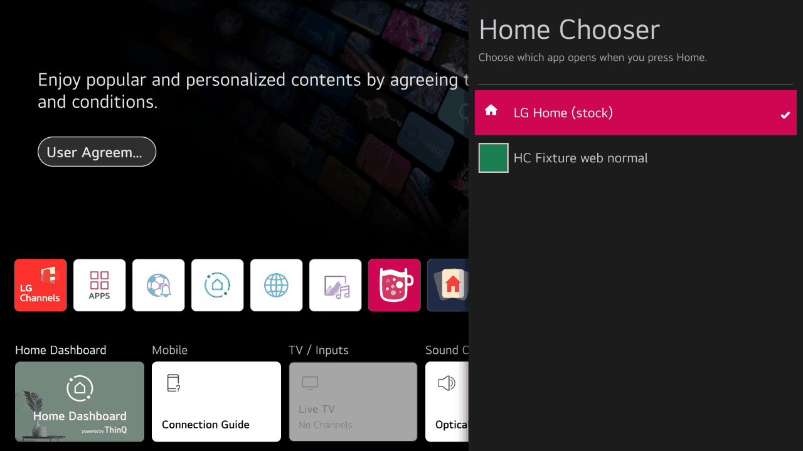
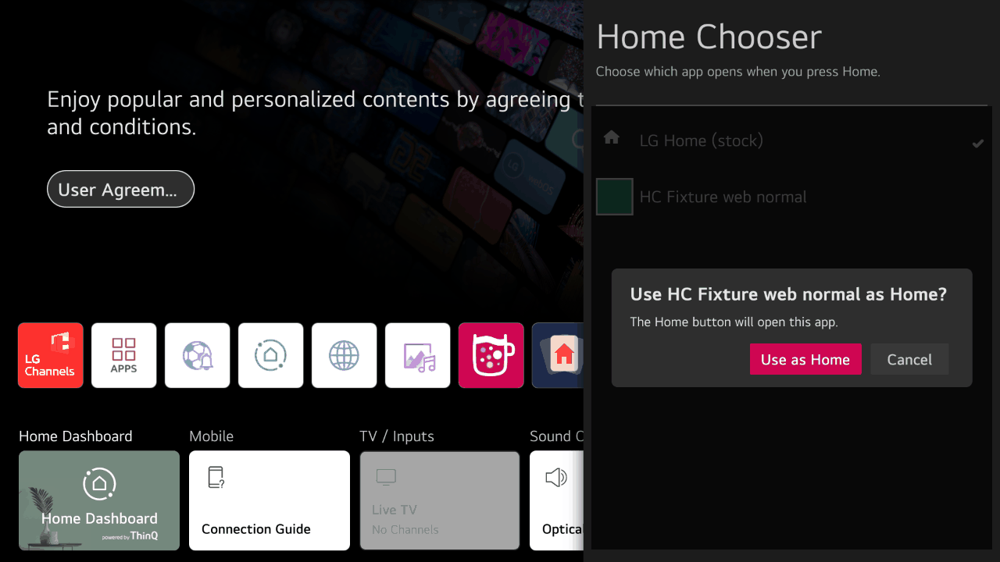
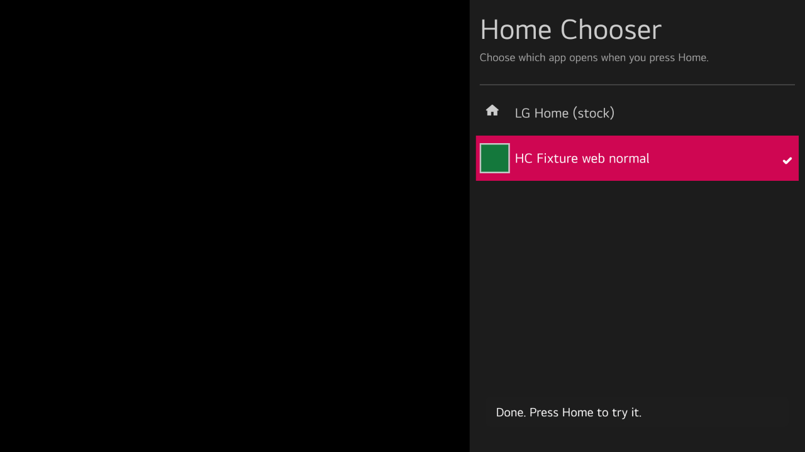

# Home Chooser

*Choose which app opens when you press Home.*

Home Chooser is a homebrew app for rooted LG webOS TVs. It lets you pick which app the Home button on
the remote opens: LG's own Home, or a launcher you have installed, such as a dock or an alternative
home screen. Your choice stays in place after the TV restarts, and Home Chooser puts LG Home back by
itself if the launcher or Home Chooser is removed.

> **Not released yet.** There is no release package so far. Launcher authors can already build
> against the [launcher API](docs/launcher-api.md): version 1 is frozen.

## Requirements

* An LG TV running webOS 5 to 12.
* The TV must be **rooted**, with [Homebrew Channel](https://github.com/webosbrew/webos-homebrew-channel)
  installed and running with root access.
* At least one launcher app. Home Chooser lists every installed app that declares itself a Home
  app; it does not include a launcher of its own.

## Installing

Install the Home Chooser package (`.ipk`) like any other homebrew app, for example with webOS Dev
Manager or `ares-install`. Then open Home Chooser once from the app list.

## Choosing a launcher

1. Install the launcher you want to use.
2. Open Home Chooser. A panel opens on the right of the screen with "LG Home (stock)" and every
   launcher on the TV; a check mark shows the current one.

   

3. Move to your launcher and press OK, then confirm "Use *name* as Home?".

   

4. When "Done. Press Home to try it." appears, press Home.

   

The change takes effect at once; no restart is needed. Nothing changes unless you confirm.

## Going back to LG Home

Open Home Chooser, choose "LG Home (stock)" and confirm. The Home button opens LG Home again
straight away.

## Uninstalling

Uninstall Home Chooser like any other app. It puts LG Home back on the Home button by itself. If you
uninstall the launcher you chose, the Home button opens LG Home again.

## Known limitations

* On webOS 11 and later, root needs a Homebrew Channel update: the current Homebrew Channel refuses
  the request, and Home Chooser says so.
* Only apps that declare themselves Home apps are listed. If your launcher is missing, ask its
  author.

## For developers

Launcher authors: see [Writing a launcher for Home Chooser](docs/launcher-api.md). Everything else:
see the [developer documentation](docs/README.md).

## Licence

Home Chooser is licensed under the [Apache License 2.0](LICENSE); see also [NOTICE](NOTICE). The package bundles third-party code and fonts under their own licences: see [THIRD_PARTY_NOTICES.md](THIRD_PARTY_NOTICES.md), which is generated by `app/scripts/third-party-notices.js`.
