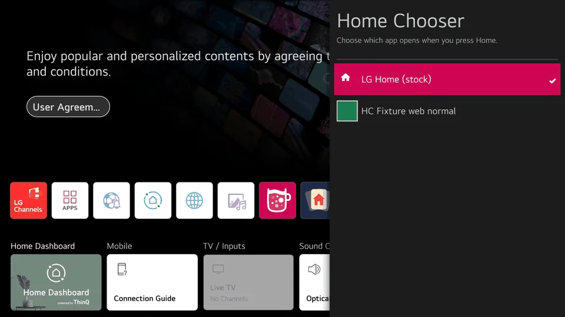
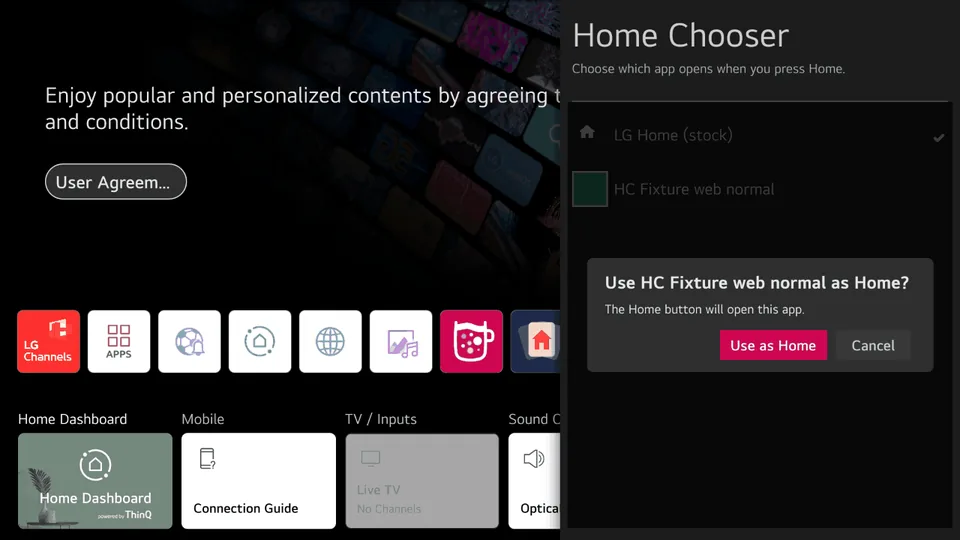
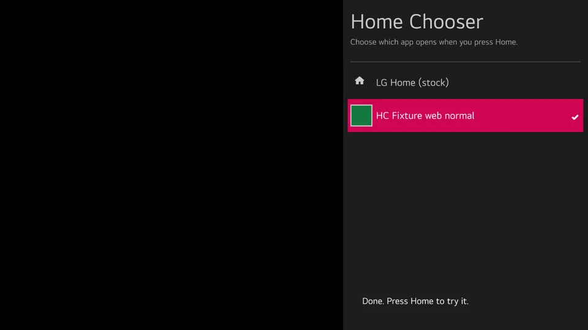

# Home Chooser

*Choose which app opens when you press Home.*

Home Chooser is a homebrew app for rooted LG webOS TVs. It lets you pick which app the Home button on
the remote opens: LG's own Home, or a launcher you have installed, such as a dock or an alternative
home screen. Your choice stays in place after the TV restarts, and Home Chooser puts LG Home back by
itself if the launcher or Home Chooser is removed.

## Requirements

* An LG TV running webOS 5 to 12.
* The TV must be **rooted**, with [Homebrew Channel](https://github.com/webosbrew/webos-homebrew-channel)
  installed and running with root access.
* At least one launcher app. Home Chooser lists every installed app that declares itself a Home
  app; it does not include a launcher of its own.

## Installing

Open Homebrew Channel on the TV, find Home Chooser in its app list and install it. Then open Home
Chooser once from the TV's app list.

Without Homebrew Channel's list, download the `.ipk` from the
[latest release](https://github.com/webosbrew/home-chooser/releases/latest) and install it like any
other homebrew app, for example with webOS Dev Manager or `ares-install`.

## Choosing a launcher

1. Install the launcher you want to use.
2. Open Home Chooser. A panel opens on the right of the screen with "LG Home (Fullscreen)" and every
   launcher on the TV; a check mark shows the current one.

   

3. Move to your launcher and press OK, then confirm "Use *name* as Home?".

   

4. When "Done. Press Home to try it." appears, press Home.

   

The change takes effect at once; no restart is needed. Nothing changes unless you confirm.

On webOS 6 to 9, with a launcher that draws over the screen (a dock or a bar), the first Home press
after choosing it can show LG Home's own screen underneath. It goes once you open an app or a TV
input.

## Going back to LG Home

Open Home Chooser, choose "LG Home (Fullscreen)" (on webOS 4.5 and 5, "LG Home (Ribbon)" or "LG Home (Fullscreen)", as you had it) and confirm. The Home button opens LG Home again
straight away.

## Uninstalling

Uninstall Home Chooser like any other app. It puts LG Home back on the Home button by itself. If you
uninstall the launcher you chose, the Home button opens LG Home again.

## Known limitations

* On webOS 11 and later, Home Chooser needs Homebrew Channel 0.8.0 or later. Earlier releases don't give apps root access there.
* The panel closes by itself after up to two minutes without a key press, as other panels on the TV
  do. Open Home Chooser again to continue; if setup was still running, it continues then.
* On webOS 5, LG Home stays loaded in the background after you choose another launcher, until the
  TV restarts.
* Only apps that declare themselves Home apps are listed. If your launcher is missing, ask its
  author.

## For developers

Launcher authors: see [Writing a launcher for Home Chooser](docs/launcher-api.md). Everything else:
see the [developer documentation](docs/README.md).

Building a launcher, by hand or with a coding agent: start from [AGENTS.md](AGENTS.md) and the
[example launcher](examples/web-launcher/README.md).

## Licence

Home Chooser is licensed under the [Apache License 2.0](LICENSE); see also [NOTICE](NOTICE). The package bundles third-party code and fonts under their own licences: see [THIRD_PARTY_NOTICES.md](THIRD_PARTY_NOTICES.md), which is generated by `app/scripts/third-party-notices.js`.
