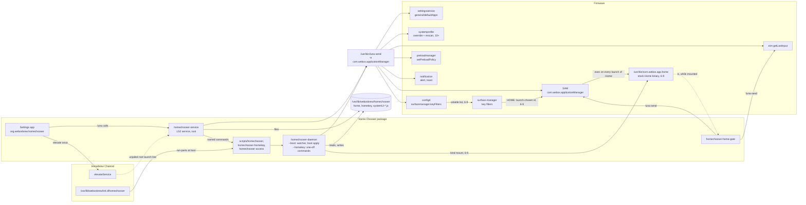
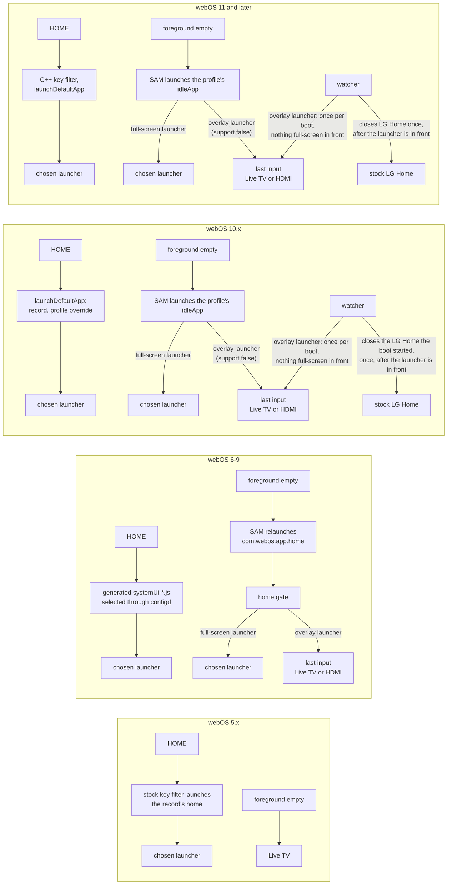
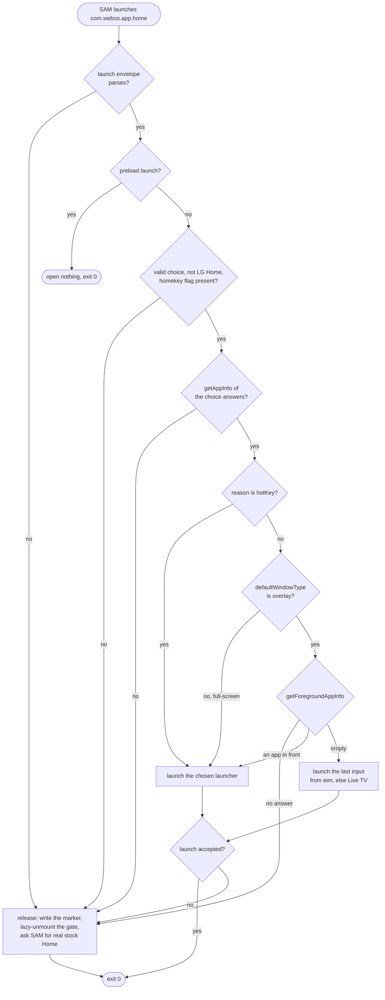
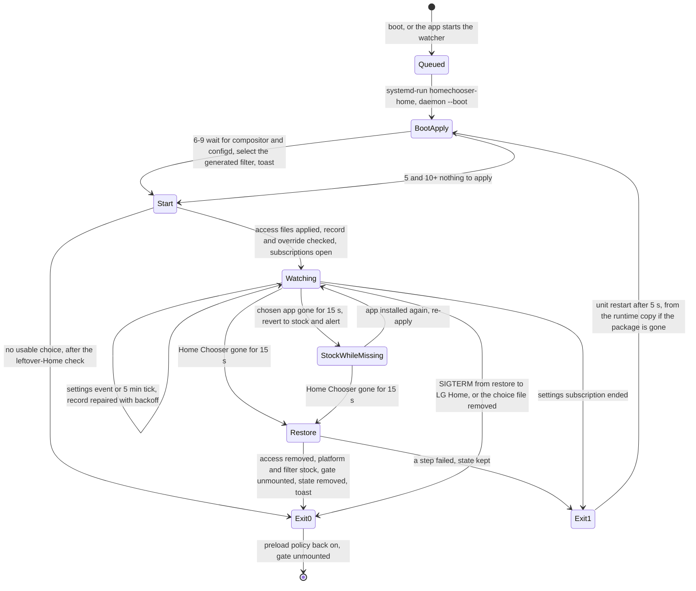
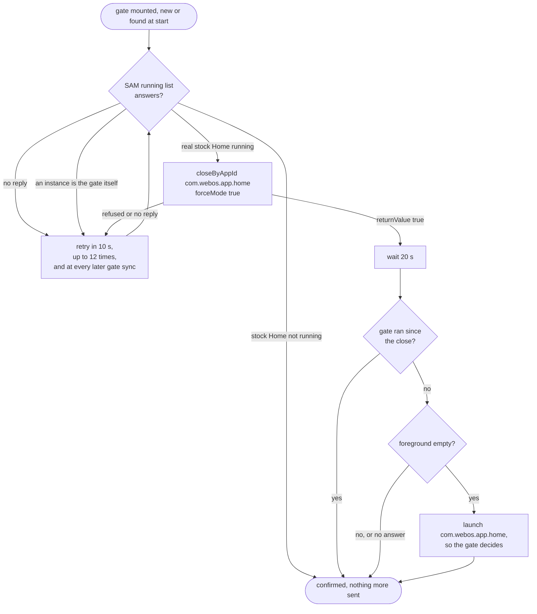

# Architecture

Home Chooser makes the remote's Home button open a launcher the owner picks, on webOS 5 to 12. One
package holds four programs:

| Program | What it is | Runs |
| --- | --- | --- |
| Settings app `org.webosbrew.homechooser` ([app/](../app/)) | Enact web app, the only UI | When the owner opens it, or a launcher asks to become Home |
| `homechooser-service` ([service/src/service/](../service/src/service/)) | Native LS2 service, elevated to root once by Homebrew Channel | On demand, when the app or a launcher calls it |
| `homechooser-daemon` ([service/src/watcher/](../service/src/watcher/), [homekey.c](../service/src/homekey.c)) | Native, root, no LS2 role of its own | At boot and after every choice, as the transient unit `homechooser-home` (`--boot`), and for one-off Home key commands (`--homekey`) |
| `homechooser-home-gate` ([service/src/gate/](../service/src/gate/)) | Native, started by SAM in place of stock Home | webOS 6–9 only, whenever SAM launches `com.webos.app.home` while a launcher is chosen |

Details: [settings-app.md](settings-app.md), [service.md](service.md),
[home-key-hook.md](home-key-hook.md), [home-gate.md](home-gate.md). The firmware facts behind the
per-release differences are in the [study](research/home-key-and-home-app.md).

## Components

* The **settings app** never calls platform services under its own identity. Every privileged
  operation goes through the service, which answers only this app for settings methods and offers
  the [launcher API](launcher-api.md) to launchers.
* The **service** is elevated by Homebrew Channel's `elevateService`, which rewrites its launch
  line so it runs as root outside the developer jail. It forwards a short allow-list of platform
  calls, reads and writes a fixed list of files, and runs named commands (the boot entry, the
  Home key commands, the access files).
* The **daemon** has no LS2 role. Every platform request it makes is a `luna-send -a
  com.webos.applicationManager` child, because the installer's `regular` role cannot call on behalf
  of an application ([service.md](service.md#package)).
* The **boot entry** is a link in Homebrew Channel's `init.d`: to the installed script on 6–9, and
  on 5 and 10+ to a persistent copy under `/var/lib/webosbrew/homechooser/boot`, so an uninstall
  made while the watcher was stopped is still undone at the next boot. It only queues
  `systemd-run --unit=homechooser-home … homechooser-daemon --boot` and returns; all waiting
  happens inside the unit.
* On **webOS 6–9** the daemon also selects a generated copy of the stock key filter through configd
  (volatile, so a reboot returns the firmware's own list) and bind-mounts the home gate over
  `/usr/bin/com.webos.app.home`. The bind source is a copy in `/tmp/homechooser-runtime/home-gate`,
  so a reboot clears it.

## The HOME key and the idle path, per webOS family

"Idle" is what SAM does when the foreground becomes empty, for example when the last app closes.

On 10.x and later SAM takes the idle app live from the system profile's `idleApp`, so the same
override that names the home also names the idle app ([settings-app.md](settings-app.md#what-is-written)).
An `idleApp` that names a missing app leaves a black screen when the last app closes, so the
override goes whenever the chosen launcher does. With `support` false SAM only falls back to the
last input once an app has been launched in the boot, so under an overlay launcher the watcher opens
the last input itself once after each boot, by the gate's rule
([settings-app.md](settings-app.md#the-last-input-after-a-boot-webos-10-and-later)).

| Family | HOME follows the choice through | Stock LG Home while a launcher is chosen |
| --- | --- | --- |
| 5.x | `general/defaultApps.home`, which the stock key filter launches directly | Not touched: the visible home, `com.webos.app.fullhome`, stays loaded until the next restart |
| 6–9 | A generated key filter that launches the chosen id ([home-key-hook.md](home-key-hook.md)) | Replaced by the home gate; the running instance is closed once |
| 10.x | The settings record and a system profile override with `home` and `idleApp` ([settings-app.md](settings-app.md#what-is-written)) | Preload off; closed once per boot and per choice after the launcher is safely in front; `idleApp` keeps SAM from starting it again |
| 11+ | Same as 10.x | Same as 10.x |

## The home gate decision

`homechooser-home-gate` runs as SAM's `com.webos.app.home` instance with the launch envelope as
`argv[1]`, decides, acts and exits 0 ([home-gate.md](home-gate.md#the-gate-program)).

Launches are made as `com.webos.app.home`. A release writes
`/tmp/homechooser-runtime/home-gate/released`, so the daemon does not mount again for the same
choice until the choice changes, the app applies again, or the TV restarts.

## Daemon lifecycle

Alongside that state machine, while a third-party launcher is chosen:

* **Preload.** On 6 and later the watcher calls `setPreloadPolicy {isEnabled:false}` for
  `com.webos.app.home` at start and on each change, retried every 10 s up to 12 times at boot, and
  sets it back to enabled on every clean exit. Nothing is written; a reboot starts with the stock
  policy ([settings-app.md](settings-app.md#the-stock-home-is-not-preloaded)).
* **Stock Home close on 6–9**, after the gate is mounted:

* **Stock Home close on 10 and later.** The watcher subscribes to SAM's foreground and life events and closes
  LG Home once per boot or choice change: for a full-screen launcher when it is in front, for an
  overlay launcher only on its own launch with a nonstock full-screen app beneath it.
* **Last input after boot on 10 and later.** With an overlay launcher chosen, 20 s after the watcher
  starts (retried every 10 s, up to 12 times, while SAM does not answer) and only if the foreground
  is empty or the overlay itself, the watcher launches the last input from eim (else Live TV), once
  per boot: a marker in `/tmp/homechooser-runtime` records the decision before the launch.
* **Restoring LG Home from the app** stops the unit first (SIGTERM: preload back on, gate
  unmounted), then removes the choice and restores the record, the profile override and the stock
  key filter list.

## Design rules

These hold across the code and are the reasons behind several choices above.

* **The platform's own default-app mechanism decides the home app** where the firmware has one: the
  `general/defaultApps` record, which SAM reads on every release from webOS 5, plus the system
  profile override that the compositor uses on 10 and later. The 6–9 key filter edit only changes
  the launch target; it adds no logic.
* **One launcher contract on every release.** A launcher declares `appCategory: ["home"]` and needs
  no per-release variant. Apps that patch the system themselves are not supported alongside Home
  Chooser.
* **Nothing persistent is changed in other services.** No edits to other services' environment
  files, units or binaries; no non-volatile configd writes. The key filter selection, the preload
  policy and the gate bind mount are runtime state that a reboot clears. Boot-time work runs only
  from Homebrew Channel's `init.d`. Home Chooser's own state lives in
  `/var/lib/webosbrew/homechooser`.
* **No restarts.** Nothing restarts the compositor, SAM or the TV, at selection or at boot.
* **LG Home always works.** A removed launcher, a removed Home Chooser, an unknown firmware shape or
  any error in the gate falls back to stock LG Home, and the owner is told once when a removal
  changed the Home button.
* **Root through Homebrew Channel only.** A rooted TV with Homebrew Channel is a requirement; the
  service is elevated once with `elevateService`.
